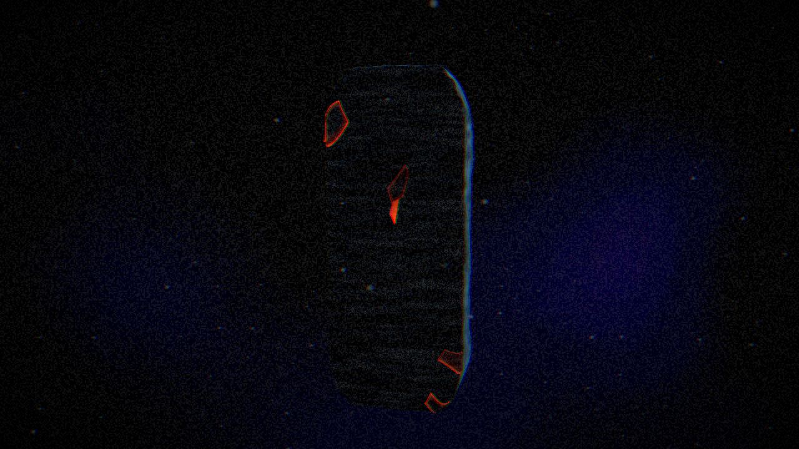
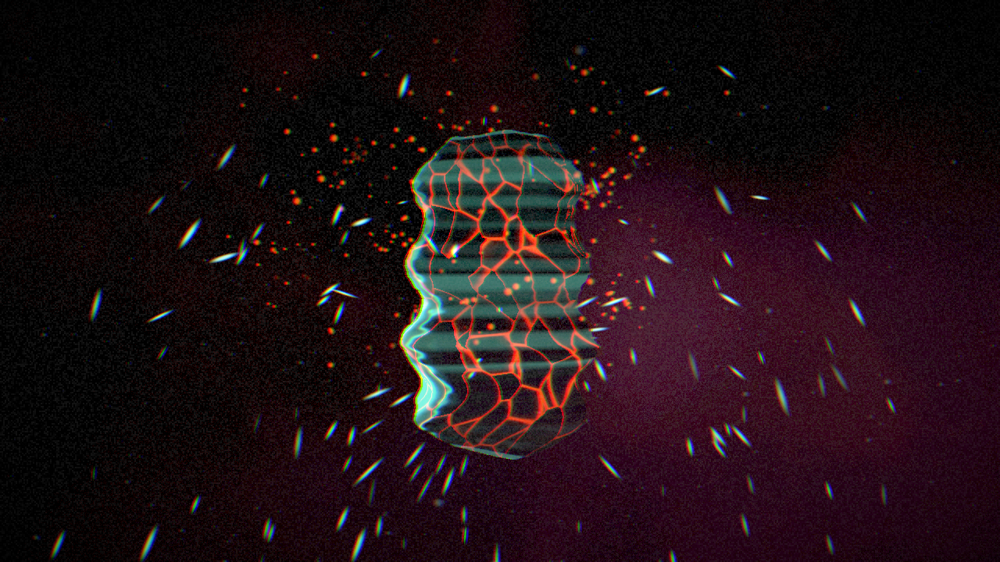
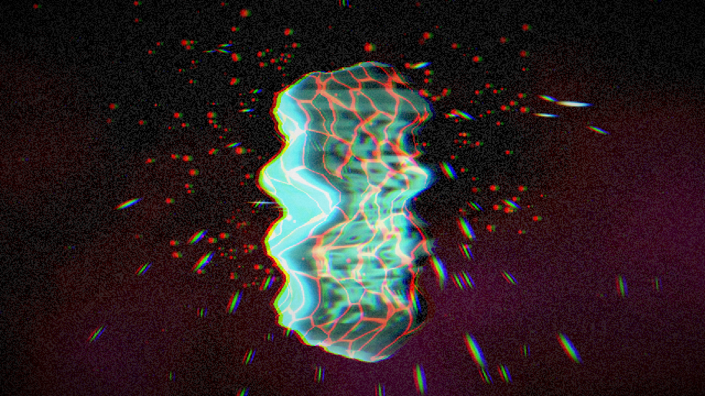

# abyss — OP-Z videolab videopak

**abyss** is a videopak for the teenage engineering OP-Z videolab, built with TE videolab 1.3.3 and Unity 2022.3.7f1, with iOS, Android and OSX builds.

An obsidian monolith breathes in a black void, with cold rim light, molten cracks, falling ash, violet smoke and a crunchy grit pass over the frame.

## Install

AirDrop `abyss.zpak` to an iPhone, or open it in the macOS OP-Z app, then pick it under **Motion**.

## Previews

*Idle.*

*Busy at 23 s, with fake notes on all 8 tracks.*

*Evolved at 41 s, with K2 at 0.55 and K1 at 0.15.*

## How damage builds up

Cracks, scars, fog, rim width and bass warp store energy that fades at a rate set by K4: about 30 s with K4 at zero. Camera orbit and sample cuts keep adding up.

## Mapping

| Track / knob | Trigger | Velocity | Pitch |
|---|---|---|---|
| 1 Kick | Shockwave ring along the slab, crack glow pulse, screen punch-zoom | Adds to crack spread (builds up) | Height of the shockwave |
| 2 Snare | Slab slices out of line, screen tears into slices | Adds lasting scars (builds up) | Slice pattern of both |
| 3 Perc | Burst of stretched shards | Number of shards (6–46) | Height the shards spray from |
| 4 Sample | Camera cut: random 40–150° orbit jump, negative-image flash | Strength of the flash | Camera push-in or pull-back |
| 5 Bass | Live twist and bulge | Lasting warp in one of three regions: notes up to 40 deform the bottom, 41–47 the middle, 48 and up the top | Where the live warp sits |
| 6 Lead | Rim light flares | Rim light widens (builds up) | Rim colour and angle |
| 7 Arp | Embers spawn and orbit | Number of embers | Angle around the slab and height |
| 8 Chord | Fog swells | Fog density and smoke rate (builds up) | Fog and smoke colour |
| K1 (CC1) | Overall darkness, up to 90% black | | |
| K2 (CC2) | Distortion: noise, pixel crunch, posterising, colour fringing | | |
| K3 (CC3) | Camera orbit speed, about 2–80°/s | | |
| K4 (CC4) | Decay: higher fades built-up effects faster | | |

The knobs are on MIDI channel 16.

## Credits

Simon Loffler ([sighmon](https://github.com/sighmon)) and Grok Bot.
